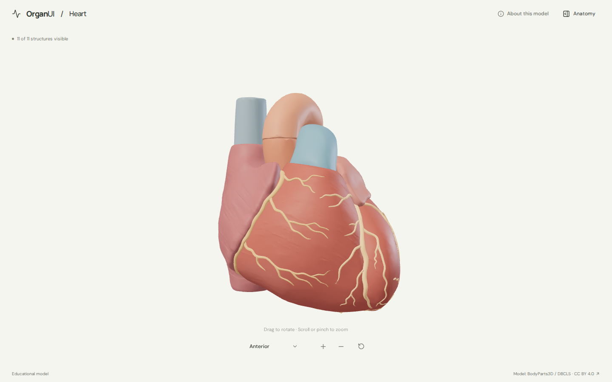
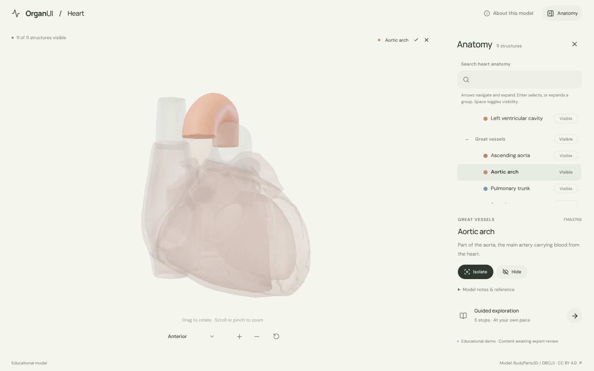
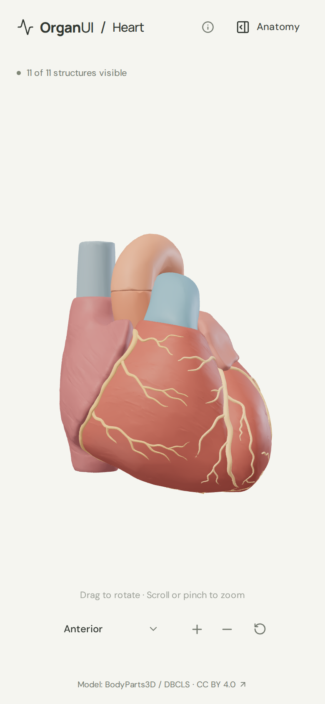
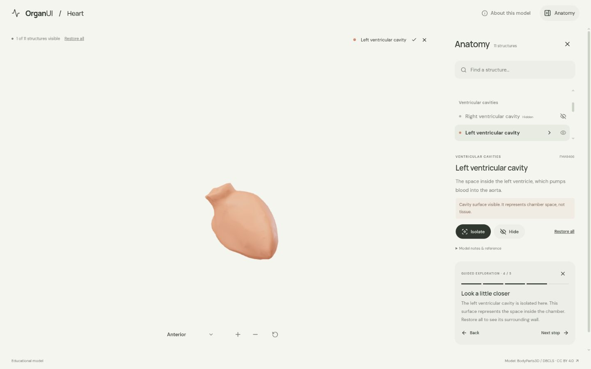

# OrganUI Heart

A minimal, standalone, open-source heart anatomy explorer built with React, TypeScript, Three.js, React Three Fiber, Vite, and Bun.

**Status:** working local demo. Eleven selectable anatomical groups, a real bundled model, responsive layouts, and verified desktop/mobile interactions. Public deployment and clinical anatomy review have not been completed.



## Run locally

Install [Bun](https://bun.sh/) **1.4.2 or newer**, then:

```sh
git clone https://github.com/organui/heart-3d.git
cd heart-3d
bun install --frozen-lockfile
bun run dev
```

Open **http://127.0.0.1:5173**. Run all commands from this repository. Vite runs under Bun (`bun --bun`); Node is not required for these scripts. No environment variables, accounts, API keys, sibling repositories, model downloads, or external font services are needed to run the app after dependency installation. The ready-to-use 2.5 MB GLB is in `public/models/`.

```sh
bun run typecheck       # TypeScript checks, including conversion scripts
bun run test            # Unit tests for selection emphasis
bun run verify:model    # Check the GLB hash, source IDs, and valid geometry
bun run build           # Typecheck and create dist/
bun run preview         # Serve the production build at http://127.0.0.1:4173
bun run format:check    # Check formatting of application and preparation code
```

The app is static and uses relative build paths. `dist/` can later be hosted on a static web server; do not open `index.html` directly with `file://`. No deployment has been performed.

## Explore

- The heart opens centered on a neutral canvas. Expand **Anatomy** to browse structures; collapse it to return to the full-width view.
- Drag to rotate; scroll or pinch to zoom. The gesture hint fades after the first rotation or zoom and stays hidden until the page reloads.
- Open the camera view selector for anterior, posterior, and left lateral presets. Manual rotation changes its label to **Custom view**; zooming preserves the view name. Use arrow keys to navigate the menu, Enter to select, and Escape to close it.
- Select a mesh or search the structure list by name, group, or FMA identifier. Selection, highlighting, and descriptions stay synchronized.
- Isolate a structure, hide it, or restore all. **Reset explorer** restores the anterior camera, zoom, visibility, selection, search, and tour state.
- Follow five guided stops, including an isolated ventricular cavity and the heart's coronary supply.
- On mobile, **Anatomy** opens the list below the model; **View in 3D** closes it and returns to the heart. Selection and search survive closing/reopening the panel.
- Click a selected structure’s name above the canvas to open its details. Escape closes the anatomy panel and returns keyboard focus to its toggle.
- Use Tab/Enter for controls. Focus the model and use arrow keys to rotate, `+`/`-` to zoom. The same anatomy information is available through ordinary text controls without WebGL. The credits dialog supports Escape and restores focus.
- Reduced-motion preferences disable orbit damping and smooth scrolling. There is no automatic spinning or heartbeat animation. Rendering is on demand, with device pixel ratio capped at 2.
- Loading shows byte progress. Missing or invalid models and WebGL startup/context failures show recovery controls while keeping the anatomy panel available.

<details>
<summary>Anatomy menu, mobile, and guided exploration screenshots</summary>







</details>

## Model, credits, and review status

> BodyParts3D, © The Database Center for Life Science licensed under CC Attribution 4.0 International.

The model is a curated subset of **BodyParts3D 4.0**, downloaded directly from the [official archive](https://dbarchive.biosciencedbc.jp/en/bodyparts3d/download.html) on **22 September 2026**. The [current official license](https://dbarchive.biosciencedbc.jp/en/bodyparts3d/lic.html) specifies **CC BY 4.0**, separately from this repository's **MIT code license**. Older OBJ comments cite CC BY-SA 2.1 Japan; the full record explains why the current archive grant is used.

Read [model provenance and preparation](docs/MODEL_PROVENANCE.md), [asset attribution](public/models/ATTRIBUTION.md), and the [complete checksum/mapping manifest](public/models/manifest.json). Fonts are locally bundled under the SIL Open Font License; [third-party notices](public/licenses/README.md) are included in the production output. Screenshots contain the same attributed model.

The selection contains two atrial walls, one combined ventricular wall, two ventricular cavity surfaces, four major vessel segments, and two coronary artery trees. **The ventricular walls are one source mesh and cannot be selected separately.** Cavity surfaces represent chamber spaces, not muscle tissue; isolate them or hide the combined wall to inspect them.

Names were checked against the archive tables and geometry was inspected. Descriptions summarize [NHLBI](https://www.nhlbi.nih.gov/health/heart/blood-flow), with links in the interface. **Expert anatomical review is pending.** This is an educational interface demonstration, not a diagnostic, treatment, measurement, or physiological simulation tool.

Known limitations:

- This is a simplified adult male reference model, not a complete or patient-specific heart. Vessel ends are truncated; colors are illustrative.
- Valves, atrial cavities, most veins, pericardium, and surrounding organs are omitted. Coronary branches are grouped into left/right trees.
- Source mappings can be incomplete. The intact ventricular wall was obtained from the IS-A hierarchy after the PART-OF ventricular wall concepts proved incomplete; the evidence is documented.
- Browser checks used desktop Chromium and mobile viewport sizes, not physical iOS/Android devices or a screen-reader audit. Reduced-motion handling was reviewed in code; actual GPU context loss was not induced.
- The Three.js/Fiber production chunk is about 793 kB before transfer compression (209 kB gzip). Vite reports a size advisory. The browser also emits a non-blocking upstream `THREE.Clock` deprecation warning from Fiber.

## Reproduce the model

The runtime asset is included. To rebuild it from verified upstream inputs:

```sh
bun run prepare:model
bun run verify:model
```

This downloads the roughly 136 MiB source archive and mapping tables into ignored `.asset-cache/`, verifies pinned SHA-256 hashes, and exports the GLB plus manifest. It needs network access only when the cache is absent. Raw assets and intermediate files are never needed at runtime and should not be committed. Conversion selects and groups real meshes, transforms coordinates, recomputes normals, and applies colors; it does not invent geometry or further simplify the archive's meshes.

## Implementation and verification

- `src/anatomy.ts`: reviewed source-ID mappings, explanatory text, and guided stops.
- `src/App.tsx`: selection/visibility state and accessible interface controls.
- `src/Viewer.tsx`: streamed loading, model validation, mesh interaction, and camera controls.
- `src/ViewMenu.tsx`: compact camera selector with keyboard navigation and focus handling.
- `src/SceneCanvas.tsx`: renderer ownership, resize handling, and recoverable graphics failures.
- `scripts/`: pinned source inputs, reproducible conversion, and independent runtime validation.

See [verification evidence and repeatable checks](docs/VERIFICATION.md). Dependencies are locked with a Bun text lockfile. React 19.2 is deliberately paired with Fiber 9.7's declared React `>=19 <19.3` peer range. The project does not import or modify the sibling OrganUI monorepo.

## License

Original application code: [MIT](LICENSE). Anatomy model, derived model images, fonts, and icons retain their separately documented licenses.

Part of [OrganUI](https://github.com/organui).
